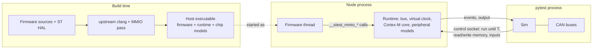

# Concepts

How stest runs firmware, and the rules that follow from it. Knowing these makes test results
(and the occasional abort) unsurprising.

## The pieces

## How firmware is compiled

Your sources and ST's HAL are compiled for the host (x86-64 or arm64) by upstream clang, at
`-O0` with debug info, with stest's LLVM pass loaded. The pass rewrites every **volatile** load
and store, which is how CMSIS declares peripheral registers, into a call to the stest runtime
(`__stest_mmio_read32(addr)` and friends). Ordinary memory accesses stay native code. Nothing in
the sources changes: `GPIOA->ODR |= 1` compiles as written, and its access reaches the GPIO
model.

Your sources are compiled with `-Dmain=stest_firmware_main`; the runtime provides the real
`main`, sets up the simulated chip, and calls your `main` on a thread of its own. The HAL is not
renamed, so `HAL_Init`, `SystemInit` and the interrupt handlers in `stm32l4xx_it.c` link as
usual; the generated chip glue supplies weak defaults for handlers you do not define and the
interrupt vector table.

## One process per node

A **node** is one MCU: one firmware executable, run as its own process. Several nodes (two
boards on a CAN bus, say) are several processes, coordinated by the `Sim` in your pytest
process over a socket. A node exits when the test process dies.

Within a node, the firmware thread and the runtime take turns: exactly one of them runs at a
time. Firmware code, interrupt handlers and model events all run in a single sequence of
virtual time, so there are no host-thread races in the simulation.

## Virtual time and quanta

Time inside a node is **virtual**, counted in nanoseconds, and has nothing to do with how long
the host takes. Each register access charges a small fixed amount; timers, ADC conversions,
CAN frames and SysTick are events scheduled on the node's virtual clock. When the firmware
sleeps (`__WFI`), the clock jumps straight to the next event, so a second of idle firmware costs
almost nothing.

The `Sim` advances all nodes in lockstep **quanta** of virtual time (default 1 ms,
`--stest-quantum-us`). Each node runs until the end of the quantum and stops there, with every
event up to that time fired. Python then sees the nodes paused at the same instant: it reads
pins, logs and variables, applies inputs, and starts the next quantum. Consequences:

- Python observes and changes a node **between quanta**. A wait such as
  `pin.wait_high(timeout_ms=600)` is checked at quantum ends. For an input at an exact instant,
  use `Pin.drive_at` or `Node.post` (see the [API reference](reference/python/sim.md)).
- Nodes exchange data (CAN frames) only at quantum boundaries, so a CAN bus caps the quantum at
  its shortest frame time (88 us at 500 kbit/s).

## Determinism

There is no wall clock and no host scheduling in the simulation. The same firmware, the same
inputs and the same quantum give a **byte-identical** event log on every run. A failure you see once, you see every time.

Each register access and event happens at the same virtual time wherever quantum boundaries
fall, and a sleeping core (`__WFI`) is not woken by quantum ends. A different quantum can still
change results in two ways:

- An input set from Python between quanta (`set_high()`, `set_voltage()`, ...) takes effect at
  the quantum boundary where the nodes are paused, so its virtual time depends on the quantum.
  `Pin.drive_at` and `Node.post` take an exact time instead.
- A polling loop dilated by poll fast-forward (below) jumps to the end of the quantum when no
  event is pending.

Keep the quantum fixed when you compare runs.

Only one thing is wall-clock: `wall_timeout_s` (default 30 s), a watchdog for a node that stops
answering, such as firmware spinning in a loop with no register access.

## Strictness

stest **aborts** rather than guesses. The node stops with an `stest: ...` message naming the
address, access width, direction and peripheral (exit status 70; `NodeCrashed` in Python) when
the firmware:

- touches an address no model covers, or a register a model does not implement;
- writes a register that is entirely read-only;
- accesses a peripheral whose RCC clock is disabled;
- uses a feature a model does not support (the message says which);
- returns from `main`.

A simulator that returned zero for an unknown register would let a test pass against behaviour
the real chip does not have. A strict abort shows you, at the first access, exactly where the
model ends. Registers that merely contain read-only bits behave as on hardware. Examples of the
messages are in [Getting started](guide/getting-started.md#first-errors).

## Register mode and HAL mode

By default every peripheral is simulated at the **register** level: ST's HAL compiles unchanged
and its register accesses drive the models, so the HAL's own logic is tested along with yours.

For a peripheral type with a shim, `stest_add_firmware(... MODELS GPIO=hal)` selects **HAL
mode**: stest replaces ST's whole HAL file for that peripheral (for GPIO,
`stm32l4xx_hal_gpio.c`) with a shim that drives the model directly. Registers, pins, EXTI setup,
event times and interrupts stay the same as in register mode. Firmware that still writes the
peripheral's registers directly keeps working, with one warning per register. Only GPIO has a
shim so far; register mode is the default for everything.

## WFI and WFE

`__WFI()` sleeps until an exception is pending (even with PRIMASK set) or taken, as on ARMv7-M.
Quantum ends do not wake it. So a `while (!flag) __WFI();` loop, with `flag` written from
Python, sees the new value at the next interrupt (SysTick, for example), not at the next
quantum.

`__WFE()` models the event register: it returns at once (clearing the register) if it is set,
and otherwise sleeps like WFI and also wakes when it becomes set. `__SEV()`, every exception
entry and return, and (with `SCB->SCR.SEVONPEND`) any newly pending interrupt set it. ST's
`HAL_PWR_EnterSLEEPMode(..., PWR_SLEEPENTRY_WFE)` (`__SEV(); __WFE(); __WFE();`) therefore
sleeps until exactly one wake-up.

## Poll fast-forward

Firmware often waits by polling a register: `while (!(ADC1->ISR & ADC_ISR_EOC));`. Running
every iteration would cost host time for nothing. After **64** consecutive loads, with no store,
that re-read (address, width, value) combinations already seen, the node jumps its clock to the
next scheduled event or the end of the quantum, whichever is first. For loops that wait on
hardware this is exact: nothing can change before the next event.

It is not exact for a loop that counts its own iterations in a non-volatile variable while
reading a constant register, such as a timeout `while (--n && !(REG & FLAG));` whose flag never
sets. Each jump stretches that loop, so it can take hundreds of times longer in virtual time than
on hardware (and, with no event pending, depends on the quantum). If a test depends on such a loop, set the
threshold with `Sim(poll_skip=N)`, `--stest-poll-skip N` or
`@pytest.mark.stest(poll_skip=N)`; `0` disables fast-forward.
