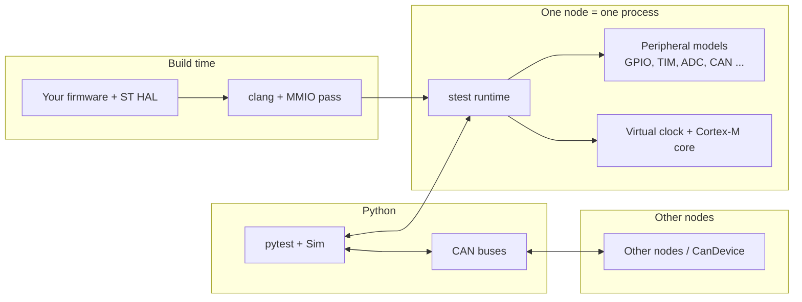

# stest

**stest runs your STM32 firmware on your computer, in deterministic virtual time, and lets you test it with pytest.**

Your real firmware and ST's unmodified HAL are compiled natively with upstream clang plus an LLVM pass. The pass turns every memory-mapped register access into a call into the stest runtime, which routes it to a register-level model of the peripheral. No emulated CPU, no board, no debugger: a firmware build is an ordinary host executable that stest drives from Python.

## What you get

- **Unmodified firmware.** Your sources and ST's HAL compile as they are. No `#ifdef SIMULATION`, no stubs.
- **Register-level peripheral models.** Clocks (RCC), power, flash, GPIO, EXTI, SYSCFG, timers, ADC, DAC, SPI and bxCAN, plus the Cortex-M core (NVIC, SysTick, WFI/WFE), ITM and DWT.
- **Deterministic virtual time.** Time is simulated in nanoseconds. The same inputs give a byte-identical event log, and the host never sleeps.
- **Strict by default.** An unmodelled register, a write to a read-only register, or access to a peripheral whose clock is off aborts the node with a message naming the address, instead of returning a silent zero.
- **pytest.** A `sim` fixture, pins, firmware variables by name, firmware logs, failure reports with each node's output and event log.
- **Multi-node CAN.** Several firmware nodes and Python devices on simulated CAN buses, with error injection.

## How the pieces fit

Each firmware node is its own process. Python's `Sim` advances all nodes in lockstep quanta of virtual time, applies inputs you drive (pin levels, analog voltages, CAN frames), and reads back outputs, events and firmware variables.

## What it is good for

- Regression tests for application logic that talks to peripherals: state machines, drivers, protocol handling, fault handling.
- Fast CI without hardware: a single node at the default 1 ms quantum costs under 0.4 s of wall
  time per virtual second, a budget CI enforces. CAN tests run at a much smaller quantum and cost
  more; two nodes on one bus can run slower than real time today
  ([A test is slow](troubleshooting.md#a-test-is-slow)).
- Multi-node systems where several MCUs talk over CAN.
- Reproducing timing-dependent bugs, since every run is repeatable.

## What it is not

- **Not cycle-accurate.** Each register access is charged a fixed amount of virtual time; instruction timing is not modelled.
- **Not an instruction-set simulator.** The firmware runs as host machine code, so there is no ARM instruction execution, no cache or bus fault timing, and host-only bugs (and host-only masking of bugs) apply.
- **Only modelled peripherals exist.** Touching anything else aborts. See the
  [support matrix](reference/support.md) for what is modelled today.
- **Bare-metal only.** RTOS ports do not compile for the host
  ([support matrix](reference/support.md#not-modelled)).

## Next

Ready to try it? Go to the [Quickstart](quickstart.md), or see [Install](install.md) for toolchain setup.
